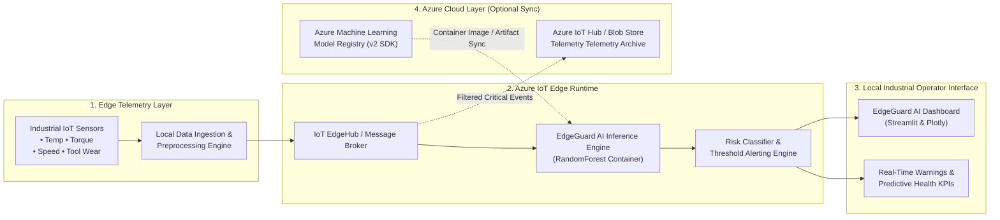

# EdgeGuard AI: End-to-End System Architecture

This document specifies the operational topology and data ingestion architecture of **EdgeGuard AI**, demonstrating the bridging of **Azure Machine Learning** (Cloud Training & Model Registry) with **Azure IoT Edge** (Local Inference & Condition Monitoring).

---

## 1. High-Level Architectural Flow

---

## 2. Core Architecture Pipeline

1. **Simulated IoT Sensors**:
   - Generates realistic multivariate sensor telemetry: Air Temperature, Process Temperature, Rotational Speed, Torque, Tool Wear, and Machine Load.
   - Models realistic physics-based failure modes: Tool Wear Failure (TWF), Heat Dissipation Failure (HDF), and Overstrain Failure (OSF).

2. **Data Ingestion & Local Normalization**:
   - Validates schema, handles outliers, and standardizes feature matrices for rapid matrix transformations.

3. **Azure ML-Trained Model Artifact**:
   - A high-efficiency `RandomForestClassifier` trained using scikit-learn on verified industrial failure profiles.
   - Registered as a versioned cloud asset in Azure ML Model Registry via `azure-ai-ml` Python SDK v2.

4. **Local Edge Inference**:
   - Deployed on-premises as an IoT Edge container module.
   - Evaluates sensor inputs with millisecond latency (< 2ms) without cloud internet dependency, ensuring zero telemetry latency and compliance with manufacturing safety protocols.

5. **Risk Classification & Explainability**:
   - Evaluates calibrated risk probability against an operational threshold (default: 50%).
   - Categorizes risk severity into *Optimal*, *Guarded*, *High Warning*, and *Critical Threat*.
   - Computes real-time feature influence contributions to explain root causes.

6. **Dashboard & Alerts**:
   - Dark industrial dashboard rendering live telemetry curves, dynamic KPI cards, confusion matrix, model evaluation metrics, and CSV export.
